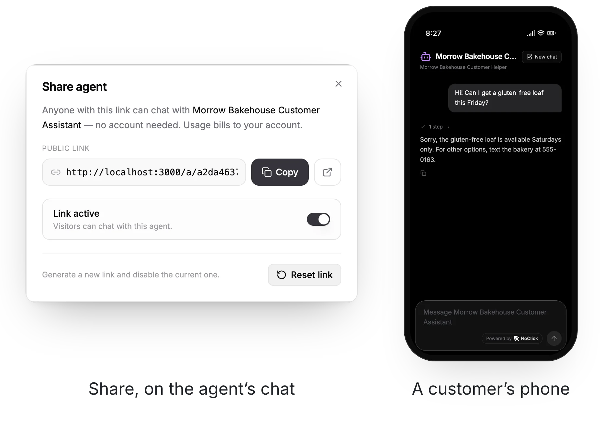
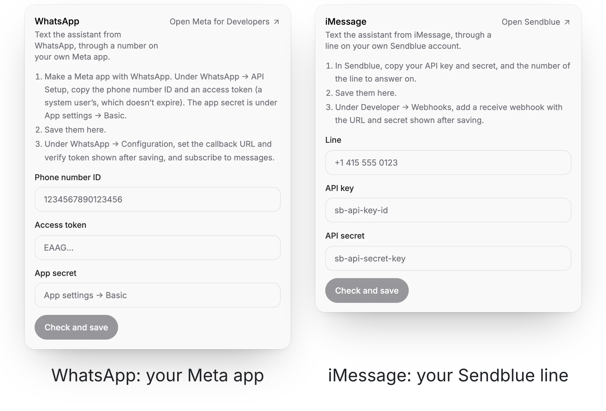

<p align="center">
  <picture>
    <source media="(prefers-color-scheme: dark)" srcset="docs/assets/title-dark.png">
    
  </picture>
</p>

<p align="center">
  <picture>
    <source media="(prefers-color-scheme: dark)" srcset="docs/assets/story-dark.svg">
    
  </picture>
</p>

<p align="center"><b>Websites are built and hosted on <a href="https://noclick.com">noclick.com</a>.</b> A self-hosted NoClick, this repo, builds agents and automations: <a href="#run-it-yourself">run it yourself</a>.</p>

Every picture below is a real run, started by the text shown: the site on noclick.com from a fresh account, the agent and the reminders on a local install of this repo.

## A website from a few facts

Text it:

```text
Can you make me a website for my bakery? Little Rye Bakery, 22 Maple Ave. Open Tue–Sun 7am–3pm, closed Mondays. Sourdough $9, croissants $4.50, gluten-free loaf on Saturdays. I want customers to be able to message me from the site.
```

<p align="center">
  <picture>
    <source media="(prefers-color-scheme: dark)" srcset="docs/assets/site-dark.webp">
    
  </picture>
</p>

Seven minutes later it was live: the bakery's name and address, its menu with prices, the hours and a message form. A first version was up in three minutes; NoClick built it again and checked the pages in a browser before it said it was done.

## On your own server: agents and reminders

A self-hosted NoClick doesn't build websites, but it builds agents and automations by text the same way.

**An agent that answers your customers.** Text it the facts and ask for an agent: its builder makes one that answers from them alone, and **Share** on the agent's chat gives a page your server serves to anyone with the link.

<p align="center">
  <picture>
    <source media="(prefers-color-scheme: dark)" srcset="docs/assets/bakery-share-dark.webp">
    
  </picture>
</p>

**Reminders, once or every weekday.**

```text
Every weekday at 2:30pm, remind me to send tomorrow's preorders to the kitchen. And in 2 minutes, remind me to take the sourdough out.
```

<p align="center">
  <picture>
    <source media="(prefers-color-scheme: dark)" srcset="docs/assets/reminders-dark.webp">
    
  </picture>
</p>

## Run it yourself

```bash
# Needs Docker. Then open http://localhost:3000
curl -fsSL https://noclick.com/install.sh | sh
```

Then link your phone, in three steps, and text it.

### Set up texting

<p align="center">
  <picture>
    <source media="(prefers-color-scheme: dark)" srcset="docs/assets/setup-keys-dark.webp">
    
  </picture>
</p>

1. **A line.** For WhatsApp, a Meta app with WhatsApp. For iMessage, a Sendblue account. Paste its keys in **Settings → Self-hosted → Texting**, which checks them.
2. **A public HTTPS address,** so Meta and Sendblue can deliver texts: `PUBLIC_WEBHOOK_URL`. On a laptop, a tunnel works.
3. **Your phone, linked.** In **Chat → Connect**, scan the code and send the message it drafts.

Chat asks for a model key (OpenRouter) first. Redis comes with the Docker install. [Step by step](./docs/self-hosting.md#texting-the-assistant).

<details>
<summary><b>What texting does, and doesn’t</b></summary>

- It answers numbers linked to an account on your instance, each person their own. Any other number gets one short note a day on how to link it; a text never makes an account.
- WhatsApp lets it write to you only within 24 hours of your last text. Past that, a reminder waits in the web chat. iMessage has no such limit.
- The Meta app and the Sendblue account are yours, on their own pricing. Texts go between them and your server, not through NoClick.

</details>

<details>
<summary><b>What’s in this repo</b></summary>

This repository is the whole platform, open source under the AGPL:

- **Chat.** The assistant on your instance, in one conversation on the web, WhatsApp and iMessage. It sets reminders, remembers what you tell it, and builds workflows when you ask.
- **The canvas.** Triggers, branches, loops, code, and 130+ integrations: Slack, Gmail, Notion, Linear, HubSpot, Stripe, Postgres, Google Sheets and the rest.
- **The AI builder.** Describe a workflow and it wires the nodes, asking only for accounts and the choices that are yours.
- **Agents with tools.** Any OpenAI, Anthropic or OpenRouter model in process, or Claude Code, Codex, OpenCode, Hermes and OpenClaw from the CLI you have installed.
- **Channels for your workflows.** Webhooks, schedules, inbound email, Slack, Discord, Telegram, WhatsApp and Twilio SMS.
- **MCP.** Point Claude Code, Claude or ChatGPT at your instance and it builds for you.
- **The workflow SDK** in [`sdk/`](./sdk) (`noclick` 0.1.x on npm and PyPI). `noclick` 0.2 and later is noclick.com’s platform API.

[noclick.com](https://noclick.com) runs this engine on NoClick’s own numbers and infrastructure. [What runs where](./docs/edition-boundary.md).

</details>

<p align="center"><a href="https://www.noclick.com/docs">Docs</a> · <a href="./docs/self-hosting.md">Self-hosting guide</a> · <a href="https://discord.com/invite/sHC2mrnss8">Discord</a></p>

<details>
<summary><b>Other ways to install</b></summary>

The same thing by hand:

```bash
git clone --branch <tag> https://github.com/noclickapp/noclick.git && cd noclick
./scripts/noclick-setup.sh
NOCLICK_VERSION=<version> docker compose up -d
```

Each run fetches the latest release, generates this instance’s secrets (the credential-encryption key is kept across re-runs) and pulls its images (about 1.5 GB the first time), and nothing is compiled on your machine. Re-run to update. Pin a release with `NOCLICK_REF=<tag>` from the [releases page](https://github.com/noclickapp/noclick/releases); `NOCLICK_BUILD=1` builds from the checkout. Every option is at the top of [`install.sh`](./install.sh).

Or deploy, with nothing to fill in: the instance prepares its database, runs its own auth and makes its own keys on first boot.

<a href="https://railway.com/new/template/noclick?utm_medium=integration&amp;utm_source=button&amp;utm_campaign=noclick"></a>
<a href="https://render.com/deploy?repo=https://github.com/noclickapp/noclick"></a>
<a href="https://cloud.digitalocean.com/apps/new?repo=https://github.com/noclickapp/noclick/tree/main"></a>

The [self-hosting guide](./docs/self-hosting.md) covers your own Postgres, storage, OAuth apps, model providers and [what each host provisions](./docs/self-hosting.md#hosted-deployments).

</details>

<details>
<summary><b>Develop from source</b></summary>

Docker, the [Supabase CLI](https://supabase.com/docs/guides/cli), Python 3.12, Node.js 20+ and pnpm, then:

```bash
pip install -r requirements.txt
make local          # local Supabase, backend and frontend; sign up with any email
```

```bash
cd backend && pytest                                   # backend tests
cd frontend && npm run typecheck && npm run build && npm test   # frontend checks
cd infra && supabase migration up --local              # migrations
```

| Path | What lives there |
|---|---|
| `backend/nodes/` | Every integration: one module per service, its config UI generated from its Pydantic model |
| `backend/wss/` | Socket.IO events, handlers and the workflow engine |
| `backend/coder/workflow/` | The workflow DSL and the AI builder |
| `backend/mcp_server.py` | The MCP server |
| `frontend/app/` | The React Router app: canvas, config panels, interfaces |
| `infra/supabase/` | Database migrations |
| `sdk/` | The workflow SDK |

</details>

## Contributing

Adding an integration is the easiest start: copy the closest module in `backend/nodes/`, register it in `backend/nodes/core/registry.py`, and its config UI generates itself. [CONTRIBUTING.md](./CONTRIBUTING.md) has the conventions; come say hello on [Discord](https://discord.com/invite/sHC2mrnss8).

## License

[AGPL-3.0](./LICENSE) (`AGPL-3.0-only`) for NoClick, [Apache-2.0](./sdk/typescript/LICENSE) for the SDKs. Run it, change it and self-host it anywhere; if you let others use a modified version over a network, offer them its source.

<details>
<summary>The details</summary>

Workflows, functions and components you build with NoClick are yours, and code that talks to NoClick over its HTTP or MCP API carries no AGPL obligation. Commercial licenses: [legal@noclick.com](mailto:legal@noclick.com). Names and logos: the [trademark policy](./TRADEMARKS.md). Releases up to v0.2.12 stay under the Sustainable Use License 1.0 they shipped with. [LICENSE](./LICENSE) is the authority.

</details>
